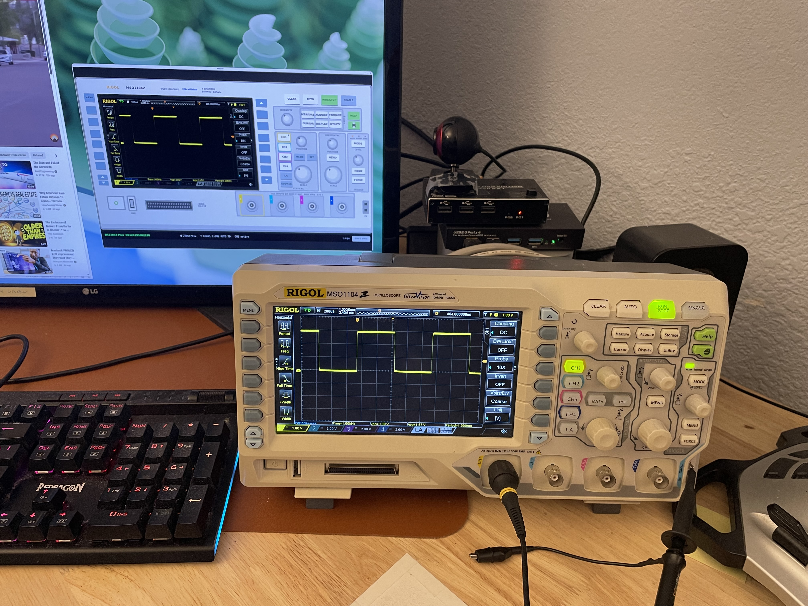

# MSO1104 front panel

A remote control for the Rigol MSO1104Z and DS1104Z oscilloscopes, and the
rest of the DS1000Z / MSO1000Z family. It drives the scope over its USB
port or its LAN port and is written in C using the AMI tool kit. The window is drawn to look like
the front of the scope: the screen at the left shows the instrument's own
display, fetched about twice a second, and the keys and knobs around it work
the real ones. The scope's menus, cursors, measurements and so on are all
driven through its own screen, so the panel is a remote control rather than
a re-implementation.

**Works with the DS1104Z too.** The MSO1104Z and the DS1104Z Plus are the
same instrument; the MSO is the DS with the logic analyser option fitted,
and both report themselves on the bus as `DS1104Z Plus`, which is what the
status strip shows. The badge on the panel says MSO1104Z as the real one
does. The other models in the family (DS1054Z, DS1074Z, DS1104Z, the Plus
and MSO versions) share the front panel layout, the screen size and the
command set, so they work the same; only the badge is different.

## Build and run

    make                     # needs ~/projects/amitk built (or set AMIDIR),
                             # libusb-1.0 and libpng
    ./mso1104                # finds the scope on USB
    ./mso1104 --net          # finds the scope on the LAN
    ./mso1104 --net 10.0.0.5 # the scope at that address (or name, host:port)
    ./mso1104 --sim          # no hardware: a simulated scope
    make sim                 # same as ./mso1104 --sim

On Linux the scope is USB device `1ab1:04ce`. The program talks to it
through libusb and detaches the kernel's usbtmc driver itself, so the only
setup is permission to open the device: a udev rule such as

    SUBSYSTEM=="usb", ATTRS{idVendor}=="1ab1", MODE="0660", GROUP="plugdev"

in `/etc/udev/rules.d/99-usbtmc.rules`, with you in `plugdev`. On the Mac
libusb and libpng come from Homebrew (`brew install libusb libpng`) and no
driver work is needed; the same `make` builds there. The program looks for
the scope every 2 s, so it can be plugged in after starting, and it
reconnects after a cable pull.

Over the LAN the scope listens on TCP port 5555 (raw SCPI, no VISA or
VXI-11 needed) once its LAN port is enabled under Utility > IO Setting.
`--net` alone searches for it: every address on each local subnet (up to
a /22) is tried on port 5555 at once, and the first that answers `*IDN?`
with a Rigol is used; the search takes about a second. `--net` with an
address or host name, optionally `:port`, probes that one. The status
strip shows the address in use. The same 2 s retry applies, so the scope
can be switched on later. If the scope stops answering, the panel notices
no picture has come for 10 s and starts the link again, searching again
if that is how it was found.

### Windows

The build is MinGW gcc from [MSYS2](https://www.msys2.org), the same
toolchain that builds amitk there, from the MSYS2 MinGW 64-bit shell:

    pacman -S --needed mingw-w64-x86_64-libusb mingw-w64-x86_64-libpng
    make                     # expects amitk built in ../amitk, or set AMIDIR
    ./mso1104.exe --sim

The executable is static apart from the system DLLs, so it runs from
anywhere once built. `amitk`'s own `setpath.bat` does not set `AMIDIR`, so
on Windows the Makefile defaults to a sister directory `../amitk`; set
`AMIDIR` if the tool kit lives elsewhere.

To talk to the real scope the device has to be bound to the WinUSB driver,
which is what libusb opens on Windows. Out of the box Windows leaves the
scope without a driver (Device Manager shows "DS1000Z Series" with a
warning), or, if NI-VISA or Rigol's UltraSigma is installed, binds it to
their usbtmc driver, which libusb cannot use. A scope with no driver is
invisible to libusb, so the panel just says no scope was found; one held by
a usbtmc driver is seen but not opened, and the status strip says so.

Binding it to WinUSB is a one time step per machine, done either way:

    powershell -ExecutionPolicy Bypass -File windows\install_winusb.ps1

installs `windows/rigol_winusb.inf`, a package that names the WinUSB driver
Windows already has. Windows will not install an unsigned package, so the
script does what Zadig does: it signs the package with a throwaway
self-signed certificate, trusts that for the moment of the install, and
removes it again. It asks for administrator rights itself. It wants
`makecat` from the Windows SDK to make the catalog and falls back to
PowerShell's `New-FileCatalog` without it. The alternative is
[Zadig](https://zadig.akeo.ie): choose "DS1000Z Series" (USB ID `1AB1
04CE`), with *Options > List All Devices* if it is not shown, select
*WinUSB* and press *Install Driver*. Going back to a VISA driver is an
uninstall of the device in Device Manager with "delete the driver
software" ticked, or `pnputil /delete-driver oemNN.inf /uninstall /force`
with the package `pnputil /enum-drivers` lists for `rigol_winusb.inf`.

The saved screen pictures go to the Desktop folder of the user profile,
`%USERPROFILE%\Desktop`, named as on the other systems.

The LAN link works on Windows as on the other systems: `--net` alone
searches the subnets of the adapters that are up (Winsock, with the
adapters listed by `GetAdaptersAddresses`), and `--net HOST` probes one
address. Virtual adapters (VirtualBox, VMware, Hyper-V, WSL) have subnets
of their own, which are searched too; each adds about a second when the
scope is not on it. Windows Firewall does not stop the search, since it is
outgoing connections only.

### If it is slow

The screen comes once or twice a second: the scope takes about 0.45 s to
render each TIFF picture (0.63 s for a PNG, measured on Windows over USB)
and then holds its next command for about 0.35 s, and the transfer itself
is a few milliseconds. AUTO stops the scope answering for about 6 s, and
the panel waits that out. If the picture stalls for longer, run with `MSO1104_TRACE=1` set in
the environment: the panel then logs every frame's fetch and decode time,
any reply that took over 100 ms, and any link loss to stderr, on every
platform.

## Using it

| Control | Action |
|---|---|
| Soft keys right of the screen | The six menu keys. The bottom one is also the back key in a submenu |
| CLEAR, AUTO, RUN/STOP, SINGLE, Help | As on the scope. RUN/STOP is lit green running, ringed red stopped |
| Print key | Saves the screen picture, as SAVE PNG does |
| MEASURE, ACQUIRE, STORAGE, CURSOR, DISPLAY, UTILITY | Open those menus |
| HORIZONTAL knobs and MENU | Position and scale knobs, horizontal menu |
| CH1 to CH4, MATH, REF, LA, Source | Channel keys ringed bright in the channel colour when the channel is on, with a dot on the one the vertical knobs act on. A channel key also makes that channel the active one |
| VERTICAL knobs | Position and scale of the active channel |
| TRIGGER MODE, MENU, LEVEL, FORCE | MODE cycles Auto / Normal / Single sweep, shown by the lamps above it; the rest as on the scope |
| BNC of a channel | Choose it as the active channel without pressing its key |
| SAVE PNG | Save the current screen picture to `~/Desktop/MSO1104_<date>_<time>.png` |

Knobs: drag up or down, use the mouse wheel over the knob, or click its
left or right half for one step. The wheel anywhere else turns the knob
last used. A right click pushes a knob: horizontal position to zero,
trigger level to half, vertical position to zero.

Keyboard shortcuts:

- `1` to `4` channel keys, `r` run/stop, `s` single, `a` auto, `c` clear,
  `h` help, `m` measure, `q` acquire, `d` display, `u` utility, `t`
  trigger menu, `F1` to `F6` the soft keys.
- Left/Right horizontal position, Up/Down horizontal scale, `+`/`-`
  trigger level, PgUp/PgDn vertical scale, Home/End vertical position.
- `x` saves the screen picture.

The window opens at 1616 by 924 so that the glass is the scope's own 800 by
480 pixels and the picture is drawn 1:1. The scope's graticule is one pixel
dotted lines in a dim grey, and it fades out if the window is made smaller
and the picture has to be shrunk; it is fine at any larger size.

The strip under the case shows the link, the timebase, the trigger and the
active channel, re-read every 2 s so changes made on the scope itself also
show up, the picture rate, and brief messages.

## What does not work

- The intensity (multi-function) knob, the soft keys left of the screen
  with their MENU key, and the page arrows have no USB command on this
  firmware. Menu items that need the knob (brightness, a measurement list)
  have to be turned on the scope.
- The power key, naturally.
- The vertical knobs are not the scope's own knobs but set the channel
  scale (1-2-5 steps) and offset (a fifth of a division per step) directly,
  so a menu that the real knobs would drive sees nothing.
- `AUTO` is sent as the `:AUToscale` command, since the key itself is not
  reachable; the effect is the same.

## Protocol

SCPI commands, over USBTMC (libusb, bulk transfers only) or over the raw
socket on the LAN port. Besides the documented command set the scope
accepts these, found by trying:

| Command | Meaning |
|---|---|
| `:SYST:KEY:PRES <key>` | Press a key. Keys: `CH1`..`CH4` `MATH` `REF` `LA` `MEAS` `ACQ` `STOR` `CURS` `DISP` `UTIL` `HELP` `SOUR` `RSTOP` `SING` `TFOR` `CLE` `HMEN` `TMEN` `F1`..`F6` |
| `:SYST:KEY:INCR <knob>,1` | Turn a knob one detent clockwise. Knobs: `HSC` `HPOS` `TLEV` |
| `:SYST:KEY:DECR <knob>,1` | One detent anticlockwise |
| `:DISP:DATA? ON,OFF,TIFF` | The screen as a TIFF in an IEEE 488.2 block |
| `:DISP:DATA? ON,OFF,PNG` | The same as a PNG |

The LAN side is plain: a command line goes in, a line comes back, or an
IEEE 488.2 block followed by a newline for the screen picture. Finding
the scope is a probe with its own sockets and short timeouts, since it
tries a subnet's worth of addresses at once. Once the scope has answered,
the link itself is an AMI network stream (`ami_opennetname`) read and
written with stdio, and the link thread simply blocks for each reply, as
the tool kit's design intends: a request and reply protocol on one stream
wants one thread and no readiness polling. No timeout bounds those waits.
Instead the front panel, which has a timer anyway, watches for the
pictures to stop; after 10 s it retires the link thread by generation
number and starts another, and the old one leaves when its read finally
returns, which may be never. The USB side is where the work is. Two
things about the instrument's USB shape the link code in `scope.c`:

- It sends 64 byte bulk packets although it enumerates at high speed, so
  the host sees every packet as a short packet. Replies are gathered piece
  by piece to the declared size, and the zero length packet that follows a
  transfer of a multiple of 64 bytes is consumed. The kernel usbtmc driver
  cannot cope with this for anything longer than 52 bytes, which is why the
  program does not use it.
- A VISA style open (remote enable, capabilities request) hangs the
  scope's USB stack until the cable is pulled. Only bulk transfers are
  used, and a half finished transfer is cleared with a USB port reset.

The screen picture is asked for as TIFF, which the scope produces in a
steady 0.45 s, where its PNG takes 0.8 to 1.6 s and its JPEG over 3 s; the
pictures are identical pixel for pixel. The TIFF is 8 bit RGB in LZW
strips, about 47 kB, and `tiff.c` reads just that shape, so no TIFF library
is needed. If the TIFF fetch or decode fails twice (older firmware, say)
the program switches to PNG, decoded with libpng. Either way the picture
is written as a 24 bit BMP, the picture format the AMI graphics module
loads, into two alternating files under `$TMPDIR`, and kept as pixels so
that SAVE PNG can encode it with libpng.

After a picture the scope holds its next command, whatever it is, for
about 350 ms two times in three, so a frame costs about 0.8 s all told and
the panel shows a little over one a second. The settings the panel uses
(timebase, the four channels' display, scale, offset and probe, and the
trigger level, source, state and sweep: 21 queries at about 1 ms each
over the LAN) are read after every frame when a pass takes under 100 ms,
and every 2 s otherwise.

## Files

- `mso1104.c`: the front panel (drawing, input).
- `scope.c`, `scope.h`: the USB and LAN links, the LAN probe, the link
  thread and command queue, the picture conversion, and the simulator.
- `tiff.c`, `tiff.h`: the reader for the scope's TIFF screen picture.
- `make shot` builds `mso1104_shot`, a test version that takes pictures of
  its own window (`MSO1104_SHOT=<file>`) and can run scripted key presses
  and knob turns (`MSO1104_SCRIPT=CH3,HSC-,TLEV+`).
- `Rigol_MSO1104Z-S.jpg`: the photograph the panel is laid out from.
- `panel.png`, `scope_and_panel.jpg`: the panel, and the scope itself with
  the panel on the monitor behind it.

## Caveats

- The panel is laid out from a photograph of an MSO1104Z-S, so the
  proportions are right but the key shapes and lettering are simplified.
- The knob step for the vertical offset and the 1-2-5 scale sequence are
  the program's, and ignore the scope's fine adjustment mode.
